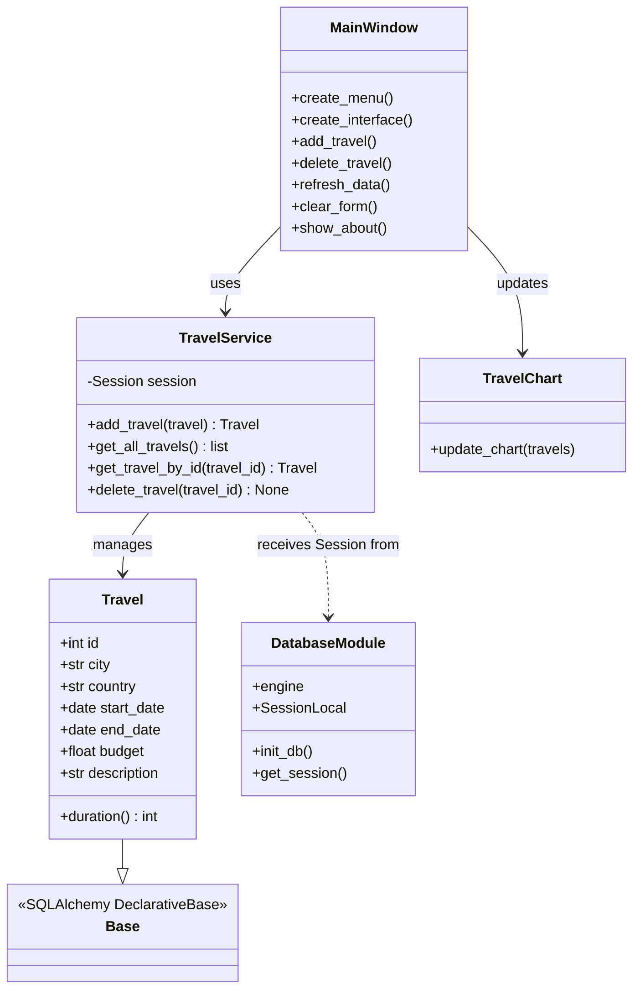

# python_lab_03 — Travel Planner

**Приложение для планирования путешествий**  
Лабораторная работа № 3 · Вариант 14

## Суть программы

Travel Planner — приложение для планирования путешествий. Пользователь может добавлять поездки, указывать город, страну, даты начала и окончания, бюджет и дополнительное описание, просматривать список поездок и удалять ненужные записи.

Проект состоит из двух интерфейсов:

- **Desktop-версия** на PySide6 — приложение с графическим окном.
- **Web-версия** на FastAPI — приложение, открываемое в браузере.

Для хранения данных используется SQLite. Доступ к базе организован через SQLAlchemy. Веб-версия запускается в Docker-контейнере, а файл базы данных хранится в подключённом томе, поэтому данные сохраняются после остановки и повторного запуска контейнера.

Программа построена с применением ООП, содержит собственные исключения, ведёт журнал действий и покрыта автоматическими тестами pytest.

## Как использовать

### Desktop-версия

После запуска приложения открывается главное окно Travel Planner. В нём доступны:

1. **Форма добавления путешествия.** Нужно заполнить город, страну, даты начала и окончания, бюджет и, при необходимости, описание.
2. **Таблица путешествий.** Показывает ID, город, страну, даты, продолжительность, бюджет и описание поездки.
3. **Кнопка «Добавить путешествие».** Проверяет введённые данные и сохраняет новую запись в SQLite.
4. **Кнопка «Удалить выбранное».** Удаляет выделенную в таблице поездку после подтверждения.
5. **Кнопка «Очистить поля».** Очищает форму.
6. **Статистика.** Показывает количество путешествий и суммарный бюджет.
7. **График активности.** Показывает количество путешествий по месяцам их начала.
8. **Меню «Файл».** Содержит обновление данных и выход из приложения.
9. **Меню «Справка».** Показывает информацию о программе.

### Web-версия

После запуска Web-версия доступна в браузере по адресу `http://localhost:8000` (при локальном запуске) или `http://localhost:8000` (при запуске через Docker).

На веб-странице доступны форма добавления путешествия, таблица поездок, статистика общего количества поездок и бюджета, график активности, а также кнопки удаления записей.

## Формат ввода параметров

| Поле | Описание | Пример |
|---|---|---|
| Город | Название города назначения | Париж |
| Страна | Название страны | Франция |
| Дата начала | Первый день путешествия | 10.06.2027 |
| Дата окончания | Последний день путешествия | 15.06.2027 |
| Бюджет | Положительное число | 1000 или 1000.50 |
| Описание | Дополнительная информация; поле необязательное | Летний отпуск |

Требования к данным:

- город и страна не должны быть пустыми;
- дата окончания не может быть раньше даты начала;
- бюджет должен быть числом больше нуля;
- продолжительность путешествия рассчитывается с включением даты начала и даты окончания.

При некорректных данных приложение показывает сообщение об ошибке и не сохраняет такую поездку.

## Как читать результат

После добавления путешествия программа обновляет таблицу и статистику.

Для каждой поездки отображаются:

- город и страна;
- дата начала и дата окончания;
- продолжительность в днях;
- бюджет;
- описание.

Дополнительно рассчитываются:

- **Количество путешествий** — число сохранённых записей;
- **Общий бюджет** — сумма бюджетов всех сохранённых путешествий;
- **Активность по месяцам** — количество поездок, сгруппированных по месяцу и году даты начала.

Продолжительность поездки рассчитывается по формуле:

`Продолжительность = (Дата окончания − Дата начала) + 1 день`.

## Примеры использования

### Пример 1. Добавление путешествия в Париж

**Ввод:**

- Город: Париж
- Страна: Франция
- Дата начала: 10.06.2027
- Дата окончания: 15.06.2027
- Бюджет: 1000
- Описание: Летний отпуск

**Результат:**

- Продолжительность: 6 дней
- Бюджет: 1000.00 €
- Запись появляется в таблице путешествий.

### Пример 2. Добавление путешествия в Рим

**Ввод:**

- Город: Рим
- Страна: Италия
- Дата начала: 01.07.2027
- Дата окончания: 05.07.2027
- Бюджет: 800

**Результат:**

- Продолжительность: 5 дней
- Бюджет: 800.00 €
- Общая статистика пересчитывается после добавления.

### Пример 3. Проверка некорректных дат

**Ввод:** дата начала — 15.06.2027, дата окончания — 10.06.2027.

**Результат:** программа сообщает: «Дата окончания не может быть раньше даты начала». Запись не добавляется.

### Пример 4. Удаление путешествия

Пользователь выбирает поездку в таблице и нажимает «Удалить выбранное» в Desktop-версии либо кнопку «Удалить» в Web-версии. После подтверждения запись удаляется, таблица и статистика обновляются.

## Архитектура проекта

```text
TravelPlanner/
│
├── core/
│   ├── __init__.py
│   ├── models.py          # ORM-модель Travel и базовый класс Base
│   ├── database.py        # Создание движка, сессий и таблиц SQLite
│   ├── services.py        # Операции добавления, чтения и удаления поездок
│   ├── exceptions.py      # Собственные исключения приложения
│   └── logger.py          # Настройка логирования
│
├── desktop/
│   ├── __init__.py
│   ├── main.py            # Точка входа Desktop-версии
│   ├── window.py          # Главное окно PySide6
│   └── charts.py          # График активности путешествий
│
├── web/
│   ├── __init__.py
│   ├── main.py            # Создание FastAPI-приложения
│   ├── routes.py          # Маршруты Web-версии
│   └── templates/
│       └── index.html     # HTML-интерфейс
│
├── tests/
│   ├── conftest.py        # Временная SQLite-база для тестов
│   ├── test_models.py     # Тесты модели Travel
│   ├── test_services.py   # Тесты сервисного слоя
│   └── test_web.py        # Тесты FastAPI-маршрутов
│
├── data/
│   └── travel.db          # Файл базы данных SQLite (создаётся автоматически)
├── logs/
│   └── travel_planner.log # Журнал работы приложения (создаётся автоматически)
│
├── Dockerfile
├── docker-compose.yml
├── .dockerignore
├── requirements.txt
├── requirements-web.txt
└── README.md
```

## UML-схема классов



## Описание основных классов и модулей

### `Travel`

ORM-модель одной поездки. Содержит идентификатор, город, страну, даты, бюджет и описание. При создании проверяет обязательные поля, корректность дат и положительное конечное значение бюджета. Метод `duration()` возвращает длительность путешествия в днях, включая обе даты.

### `TravelService`

Сервисный класс для работы с путешествиями через SQLAlchemy-сессию. Реализует добавление записи, получение списка, поиск по идентификатору и удаление. При ошибках базы данных выполняет откат транзакции там, где это необходимо, и использует собственное исключение `DatabaseError`.

### `MainWindow`

Главное окно Desktop-версии на PySide6. Создаёт меню, форму ввода, таблицу, кнопки, статистику и график. Передаёт операции с данными сервисному классу `TravelService`.

### `TravelChart`

Виджет графика на основе Matplotlib. Метод `update_chart(travels)` строит график количества путешествий по месяцу и году начала поездки.

### Модуль `database.py`

Создаёт SQLAlchemy engine и фабрику сессий `SessionLocal`, автоматически формирует таблицы методом `init_db()` и предоставляет генератор сессий `get_session()`. По умолчанию используется SQLite-файл `data/travel.db`. URL базы можно переопределить через переменную окружения `DATABASE_URL`.

### Web-модули

`web/main.py` создаёт FastAPI-приложение и при запуске инициализирует базу данных. `web/routes.py` содержит маршрут главной страницы, добавления и удаления путешествий. HTML-шаблон находится в `web/templates/index.html`.

## Автотесты

Проект включает **15 автоматических тестов pytest**. Они проверяют модель путешествия, сервисный слой и маршруты веб-приложения.

### Что проверяется

**Модель (`test_models.py`):**

- корректное создание путешествия;
- расчёт продолжительности;
- запрет пустого названия города;
- запрет даты окончания раньше даты начала;
- запрет отрицательного бюджета;
- обработка нечислового бюджета.

**Сервис (`test_services.py`):**

- добавление путешествия;
- получение списка путешествий;
- удаление путешествия;
- поиск путешествия по ID;
- обработка ситуации, когда запись не найдена.

**Web (`test_web.py`):**

- открытие главной страницы;
- добавление путешествия через HTTP-маршрут;
- удаление путешествия через HTTP-маршрут;
- обработка неправильных дат при добавлении.

Для тестов используется отдельная временная SQLite-база. Тестовые операции не изменяют рабочий файл `data/travel.db`.

### Запуск тестов

Из корневой папки проекта выполните:

```powershell
python -m pytest -v
```

### Результат тестирования

Выполненный запуск проекта показал:

```text
======================== 15 passed, 1 warning in 6.16s ========================
```

Все 15 тестов пройдены успешно. Дополнительно выводится предупреждение `StarletteDeprecationWarning`, связанное с использованием `httpx` в `starlette.testclient`. Это предупреждение о будущем изменении совместимости, а не ошибка тестов.

## Технические требования

### Системные требования

- ОС: Windows 11 (проект также может запускаться в Linux и macOS при установленном Python и необходимых зависимостях).
- Python: 3.13.14 — версия, на которой проверялся проект.
- Для Desktop-версии: графическая среда и установленные зависимости PySide6 и Matplotlib.
- Для Web-версии в Docker: Docker Desktop с работающим Docker Engine; в Windows рекомендуется настроенный WSL2 backend.

### Используемые библиотеки

| Библиотека | Назначение |
|---|---|
| PySide6 | Графический интерфейс Desktop-версии |
| Matplotlib | Построение графика активности |
| FastAPI | Web-приложение и HTTP-маршруты |
| Uvicorn | Запуск ASGI-приложения |
| SQLAlchemy | ORM и работа с базой данных |
| SQLite3 | Файловая база данных; модуль входит в стандартную библиотеку Python |
| Jinja2 | Формирование HTML-страницы |
| python-multipart | Обработка HTML-форм |
| pytest | Автоматическое тестирование |
| httpx | HTTP-клиент для тестирования FastAPI |

### Хранение данных и ограничения

- Рабочая база данных по умолчанию находится в `data/travel.db`.
- Журнал приложения находится в `logs/travel_planner.log`.
- В Docker файл базы данных расположен внутри контейнера по пути `/app/data/travel.db`, который связан с локальной папкой `./data`.
- Приложение хранит сведения о поездках: город, страну, даты, бюджет и описание.
- В текущей версии не реализованы учёт пользователей, авторизация, бронирование билетов и отелей, а также синхронизация с внешними туристическими сервисами.
- График показывает число путешествий по месяцу и году даты начала, а не фактические расходы по дням.

## Как запустить

### Вариант 1. Локально в Windows (разработка)

Откройте терминал в корневой папке проекта.

Создайте виртуальное окружение:

```powershell
python -m venv venv
```

Активируйте его:

```powershell
.\venv\Scripts\Activate.ps1
```

При необходимости установите зависимости:

```powershell
python -m pip install -r requirements.txt
```

Запустите Desktop-версию:

```powershell
python -m desktop.main
```

Для запуска Web-версии остановите Desktop-приложение при необходимости и выполните:

```powershell
python -m uvicorn web.main:app --reload
```

Откройте в браузере `http://127.0.0.1:8000`.

Запуск тестов:

```powershell
python -m pytest -v
```

### Вариант 2. Web-версия через Docker Compose

Установите и запустите Docker Desktop. Из корневой папки проекта выполните:

```powershell
docker compose up --build
```

После запуска откройте `http://localhost:8000`.

Для запуска в фоновом режиме:

```powershell
docker compose up -d --build
```

Проверить состояние контейнера:

```powershell
docker compose ps
```

Остановить контейнеры:

```powershell
docker compose down
```

Данные SQLite сохраняются в локальной папке `data`, подключённой к контейнеру через volume. Поэтому записи сохраняются после остановки и повторного запуска контейнера.

## Сложности лабораторной работы

В проекте реализованы все три уровня задания:

- **Rare:** Desktop-приложение с графическим интерфейсом PySide6, таблицей путешествий, формой ввода, графиком активности, логированием, меню и обработкой собственных исключений.
- **Medium:** хранение данных в SQLite и автоматические тесты pytest.
- **Well-done:** Web-версия на FastAPI, запускаемая в Docker-контейнере; файл SQLite сохраняется в постоянном Docker volume.

Примечание: SQLite является файловой базой данных, а не отдельным сервером БД. В этой реализации в Docker развёрнуто FastAPI-приложение, использующее SQLite-файл из подключённого постоянного тома. Если преподаватель трактует требование Well-done как обязательное развёртывание отдельного сервера базы данных, это условие нужно дополнительно согласовать.

## Вывод

В ходе лабораторной работы разработано приложение Travel Planner для планирования путешествий, вариант 14. Реализованы Desktop- и Web-версии, объектно-ориентированная структура, хранение данных в SQLite, проверка введённых параметров, собственные исключения и логирование. Для анализа активности реализован график, а основные функции проверены автоматическими тестами pytest. Web-версия запускается в Docker, при этом данные сохраняются в постоянном томе. В результате получено приложение, демонстрирующее работу с графическим интерфейсом, базой данных, тестированием и контейнеризацией.
